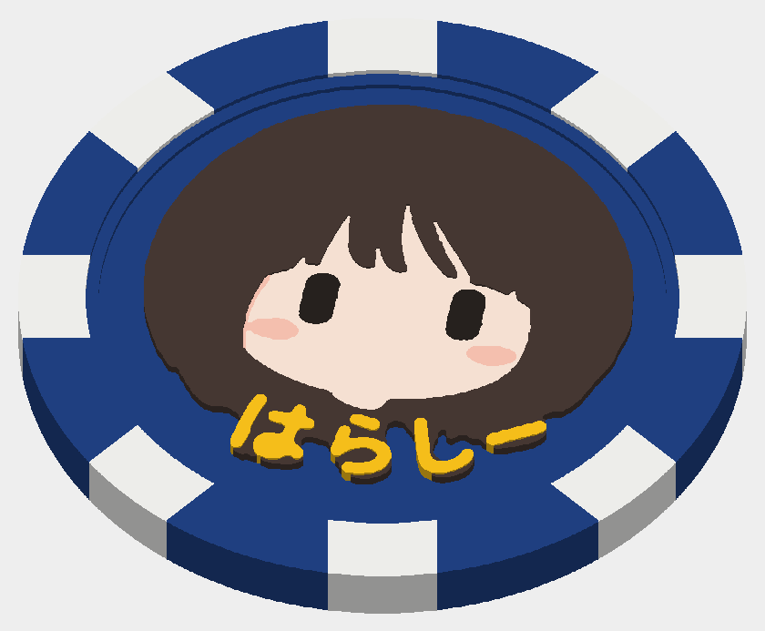
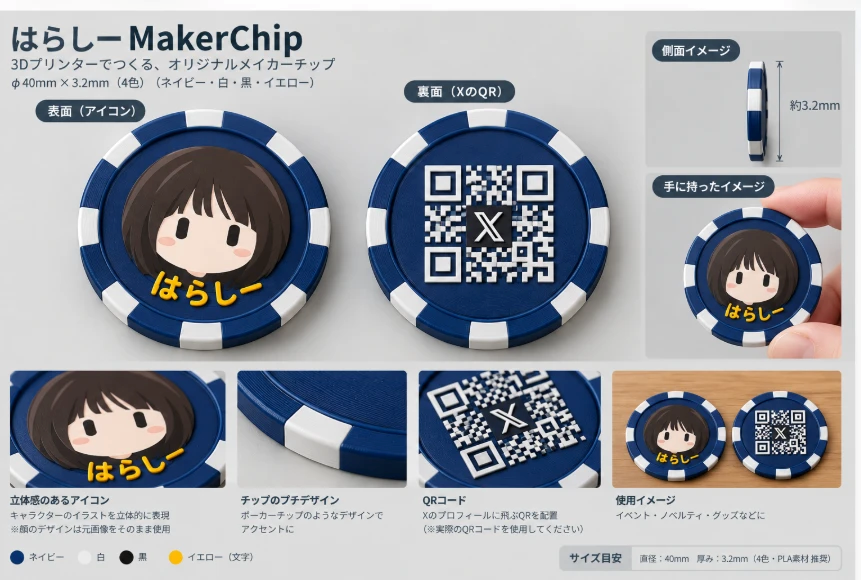
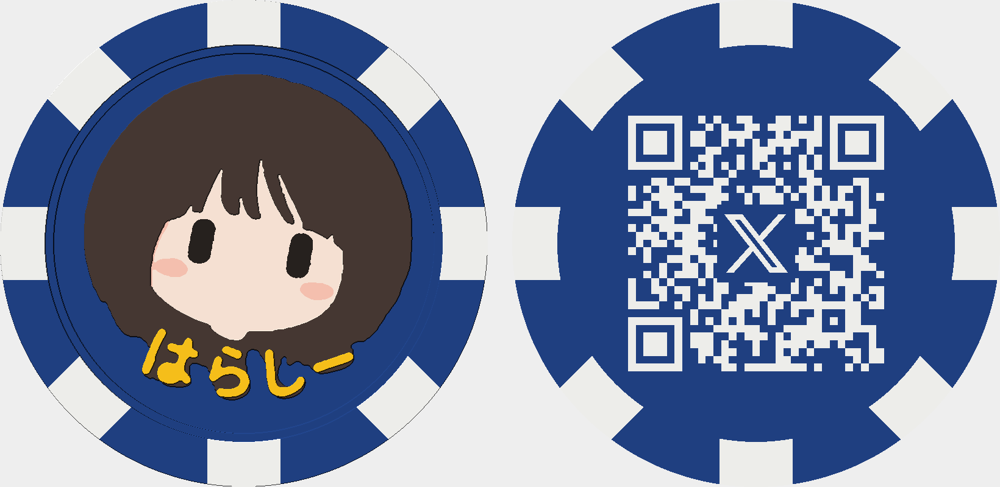

# はらしー MakerChip

3Dプリンターでつくる、ポーカーチップ風のオリジナルメイカーチップです。

- **サイズ**：直径40mm × 厚さ3.2mm
- **表面**：アイコン（立体）＋「はらしー」の文字
- **裏面**：XプロフィールのQRコード（https://x.com/hara_shiiii）
- **組み立て不要**：AMSで一度に印刷すると、そのまま1枚のチップになります

| 完成イメージ | データ（左：表面／右：裏面） |
|---|---|
|  |  |

## ファイル

| ファイル | 内容 |
|---|---|
| [`makerchip_AMS4.3mf`](makerchip_AMS4.3mf) | Bambu Studio用。色の割り当て済み（**まずはこれ**） |
| [`stl/`](stl) | 色ごとに分けたSTL 7個（3MFが使えないとき用） |

## フィラメント（AMS 1台・PLA）

| スロット | 色 | パーツ |
|---|---|---|
| 1 | ネイビー | 本体 |
| 2 | 白 | ストライプ・QR・Xマーク・顔・頬 |
| 3 | こげ茶（なければ黒） | 髪・目 |
| 4 | イエロー | 文字 |

## 印刷手順（Bambu Studio）

1. `makerchip_AMS4.3mf` を開く
2. AMSを同期し、スロットを上の4色に合わせる
3. 積層ピッチ **0.2mm**、ノズル **0.4mm** でスライス
4. 印刷（プレートは **スムースPEI** 推奨。裏面のQRがきれいに出ます）

プレートからはみ出したら「配置（A）」を押してください。

### STLを使う場合

7個まとめてドラッグ →「1つのオブジェクトとして読み込みますか？」で **はい** → 各パーツにスロットを割り当てます。

| STL | スロット |
|---|---|
| `1_navy` | 1 |
| `2_white` / `5_skin` / `6_cheek_pink` | 2 |
| `3_hair_brown` / `7_eye_black` | 3 |
| `4_yellow` | 4 |

7個をバラバラに単色印刷して組み立てることはできません。

## 注意

- 側面の白ストライプのため、全層で色替えが起きます。チップ本体より色替えで捨てるフィラメントのほうが多くなるので、**プレートにコピーして5〜10枚まとめて刷る**のがおすすめです。
- 印刷後、裏面のQRがスマホで読めるか確認してください（白黒反転のQRです。iPhone標準カメラ／Googleレンズで読めます）。
- 7色使える環境なら、`5_skin` を肌色（ベージュ）、`6_cheek_pink` をライトピンク、`7_eye_black` を黒にすると、完成イメージにより近くなります。
